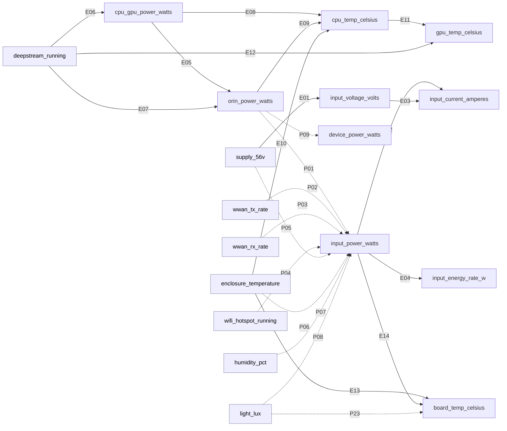
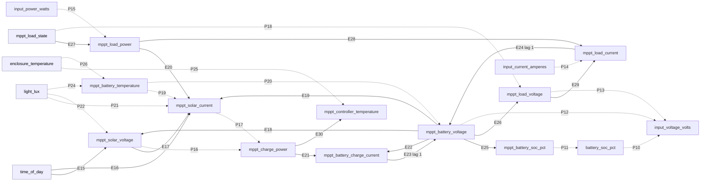

# Hand-specified graph, v0 (draft for BusPas review)

Built 9 November 2026. Not frozen: it gets frozen (dated commit) after the BusPas review, before any test-period run.

## Files

- `edges.csv`: every edge with its kind, sign, lag, reason, main source and BusPas question.
  - **E** edges (30) are drawn.
  - **P** edges (26) are pending: the documentation supports them, but they depend on how the sign is built or wired.
  - **X** edges (4) are not drawn, and each row says why.
- `nodes.csv`: the 22 measured and 14 context nodes, with the raw metric behind each.
- `QUESTIONS_BUSPAS.md`: 15 questions for one meeting with a BusPas engineer. Q1 matters most.
- `sources.json`: for each edge, the quotes the checking agents confirmed, plus all 361 quoted facts from the research step.

## How it was built

1. **Nodes** come from the dataset README: what each sign reports. No telemetry values, correlations, the pilot graph or the slide deck were used.
2. **Research.** Nine agents read one source each and pulled out quoted facts:
   - the NVIDIA Jetson Linux power and thermal pages
   - the Thermal Design Guide and the module Design Guide
   - the TI INA238 and INA3221 datasheets
   - DeepStream and LTE modem documents
   - solar charge-controller manuals
   - the README definitions
   - physics and application notes
3. **Drafts.** Three agents each drafted the edges on their own from those facts. Of the 60 distinct edges they proposed, 53 came from two or more drafters.
4. **Checks.** Each edge was checked twice, once against its sources and once for its mechanism. When the two checks disagreed (39 edges), a third agent decided. A completeness critic then added one edge (E18).
5. **Editor's changes.** These are listed in the `note` column:
   - The solar load triple is written as I = P / V, which removed a cycle.
   - `wwan_tx_rate -> input_power_watts` moved to pending, because it depends on the same wiring question as `wwan_rx_rate`.
   - One edge kind was relabelled.

## Conventions

- **Context nodes** are inputs only: they have no parents and are never checked.
- **Power = voltage × current:** current is the child (I = P / V). Power then stays the node that workload explains.
- **Lags:** within one hour the graph is acyclic. The only lagged edges (lag 1 h) are battery charge and discharge acting on battery voltage.
- **No fans:** cooling is passive. Throttling at 99 °C, power-limit throttling, under-voltage and leakage are documented feedback loops. They are not drawn, because they would close a cycle within the hour (see the BusPas questions).
- **Unobserved loads** (heater, display, throttling state) are not nodes.

## Power and heat (all signs)

Solid = drawn, dashed = pending BusPas, blue = context.

## Solar block (13 signs)

## Known gaps

- **`input_power_watts` has no drawn parent.** The main energy node waits on Q1: does the module, modem, display and heater power pass through the INA238?
- **No edges yet** for `device_power_watts` (undefined), `battery_soc_pct` and `mppt_battery_temperature`.
- **`mppt_charge_power` has no parents.** It is unclear whether it is measured on the panel side or the battery side (Q14).
- **Weakest drawn edges:**
  - E10 and E13 assume the environment sensor shares air with the module and the INA238 (Q13).
  - No single source states E12 end to end.
  - E28 and E29 rest on one controller family's register map.
- **Clean before use:**
  - `gpu_temp_celsius = -256` (GPU power-gated) is missing data, not a temperature.
  - The MPPT placeholder values of exactly 100 must be removed.
  - Hours that contain an energy-counter reset break E04.
